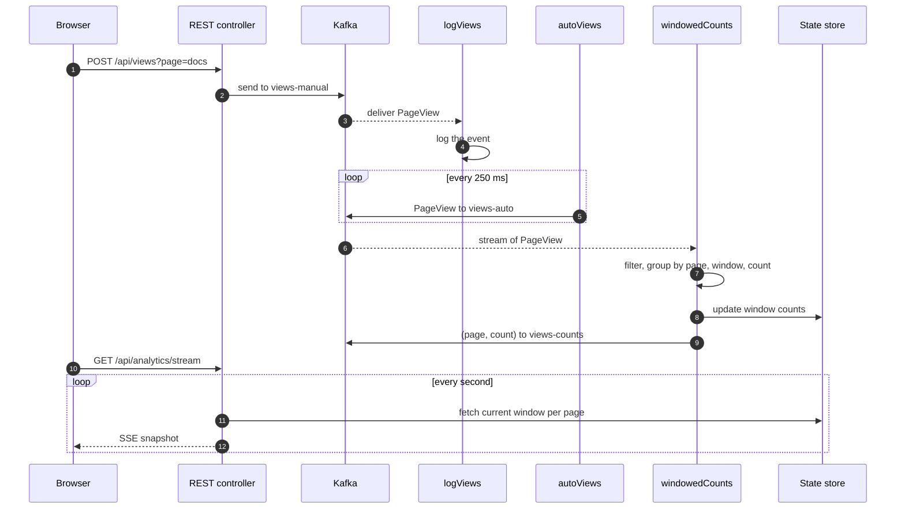
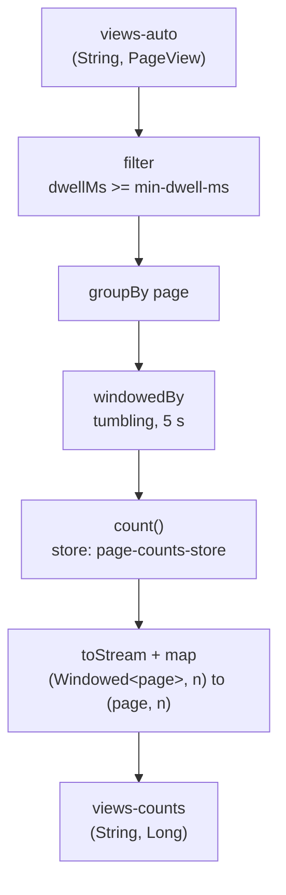

# Event-Driven Pipeline

Event-driven pipeline built with **Spring Boot**, **Spring Cloud Stream** and **Kafka Streams**
It generates, consumes, and processes page events in real time, analyzes page views with Kafka Streams, and displays results through a web interface using Server-Sent Events

---

## Features

| Capability | How it is implemented |
|---|---|
| Publish events over HTTP | `POST /api/views` → `StreamBridge` → topic `views-manual` |
| Consume events | `logViews` (`Consumer<PageView>`) reads `views-manual` |
| Generate events automatically | `autoViews` (`Supplier<PageView>`) writes to `views-auto` every 250 ms |
| Windowed aggregation | `windowedCounts` (`Function<KStream, KStream>`) → `views-counts` |
| Live query of the aggregate | `InteractiveQueryService` on the `page-counts-store` window store |
| Live dashboard | Server-Sent Events at `/api/analytics/stream`, rendered by `static/index.html` |

## Architecture

```mermaid
flowchart LR
    subgraph APP["Spring Boot application"]
        API["POST /api/views"]
        LOG["logViews<br/>Consumer"]
        GEN["autoViews<br/>Supplier"]
        AGG["windowedCounts<br/>KStream processor"]
        SSE["GET /api/analytics/stream"]
    end

    API -- StreamBridge --> T1[("views-manual")]
    T1 --> LOG
    GEN --> T2[("views-auto")]
    T2 --> AGG
    AGG --> T3[("views-counts")]
    AGG -. materialises .-> STORE[("page-counts-store")]
    STORE -. interactive query .-> SSE
    SSE -- SSE --> UI["Browser dashboard"]
    UI -- click "Send View" --> API
```

### Request / event flow



## Stream topology



The `PageView` event:

| Field | Type | Meaning |
|---|---|---|
| `page` | string | Logical page name (`home`, `docs`, …) |
| `visitor` | string | Anonymous visitor id |
| `viewedAt` | long | Event time, epoch milliseconds |
| `dwellMs` | long | Time spent on the page, milliseconds |

## Project layout

```
.
├── compose.yml                         # single-node Kafka (KRaft, no ZooKeeper)
├── pom.xml
├── docs/screenshots/                   # images used by this README
└── src
    ├── main
    │   ├── java/io/example/pageviews
    │   │   ├── PageViewsApplication.java
    │   │   ├── config/PageViewProperties.java      # pageviews.* settings
    │   │   ├── model/PageView.java                 # event record
    │   │   ├── messaging/
    │   │   │   ├── Topics.java                     # topic + store names
    │   │   │   ├── PageViewFunctions.java          # Consumer / Supplier / Function beans
    │   │   │   └── PageViewTopology.java           # pure Kafka Streams logic
    │   │   └── web/
    │   │       ├── ViewPublisherController.java    # POST /api/views
    │   │       └── AnalyticsController.java        # snapshot + SSE
    │   └── resources
    │       ├── application.yml
    │       └── static/index.html                   # live dashboard
    └── test/java/.../PageViewTopologyTest.java
```

## Getting started

### Prerequisites

- Java 21
- Docker with Docker Compose (or a local Kafka 3.x broker on `localhost:9092`)
- Maven is optional: the included wrapper (`./mvnw`) is enough

### 1. Start Kafka

```bash
docker compose up -d
```


Optional sanity check with the console tools shipped in the image:

```bash
docker exec -it pageviews-kafka /opt/kafka/bin/kafka-topics.sh \
  --bootstrap-server localhost:9092 --list
```

### 2. Run the application

```bash
./mvnw spring-boot:run
```

The app listens on <http://localhost:8080>. Topics are created automatically on first use.

## Try it out

**Publish a view manually**

```bash
curl -X POST "http://localhost:8080/api/views?page=docs"
```

The consumer logs it in the application console:


**Watch the generated traffic**

```bash
docker exec -it pageviews-kafka /opt/kafka/bin/kafka-console-consumer.sh \
  --bootstrap-server localhost:9092 --topic views-auto --from-beginning
```


**Read the aggregated counts**

```bash
docker exec -it pageviews-kafka /opt/kafka/bin/kafka-console-consumer.sh \
  --bootstrap-server localhost:9092 --topic views-counts \
  --property print.key=true \
  --value-deserializer org.apache.kafka.common.serialization.LongDeserializer
```


**Query the live state store**

```bash
curl http://localhost:8080/api/analytics/snapshot
# {"at":1767225600000,"counts":{"home":4,"pricing":3,"docs":5,"blog":2}}

curl -N http://localhost:8080/api/analytics/stream      # SSE feed
```

**Open the dashboard** at <http://localhost:8080/>

## Configuration

All settings live in `src/main/resources/application.yml`

| Property | Default | Description |
|---|---|---|
| `pageviews.pages` | `home,pricing,docs,blog` | Pages used by the generator and the dashboard |
| `pageviews.visitors` | `visitor-a,visitor-b,visitor-c` | Visitor ids used for random events |
| `pageviews.min-dwell-ms` | `100` | Views shorter than this are dropped by the aggregation |
| `pageviews.window-seconds` | `5` | Tumbling window size |
| `spring.integration.poller.fixed-delay` | `250` | Interval between generated events (ms) |
| `spring.cloud.stream.kafka.binder.brokers` | `localhost:9092` | Broker for the plain Kafka binder |
| `spring.cloud.stream.kafka.streams.binder.brokers` | `localhost:9092` | Broker for the Kafka Streams binder |
